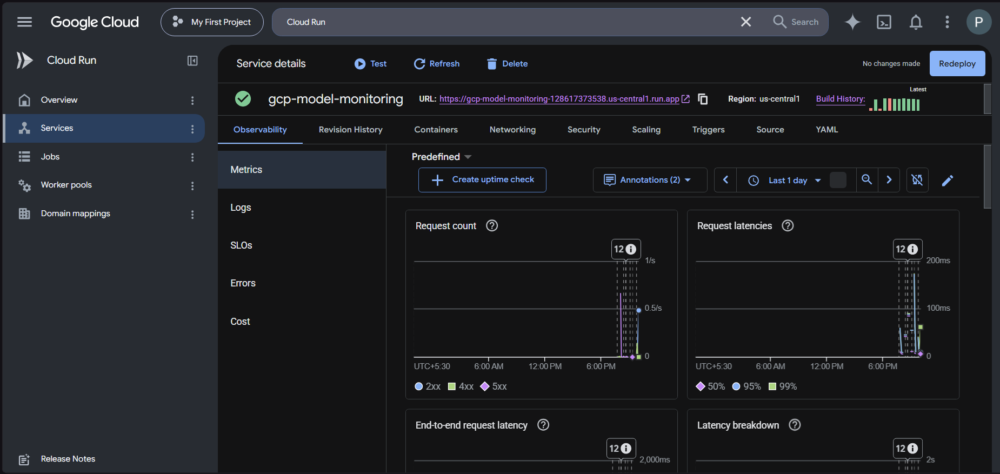
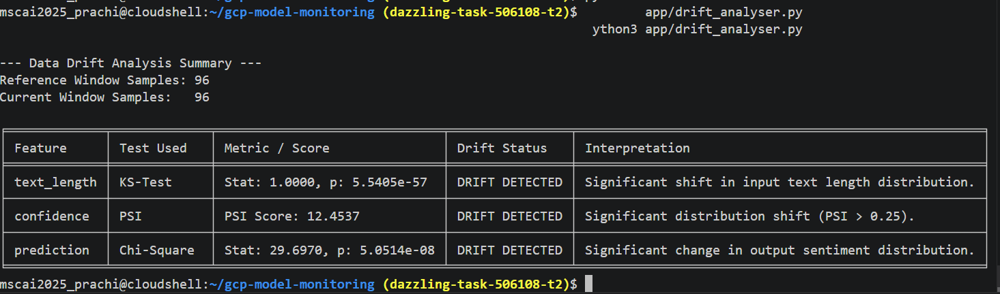
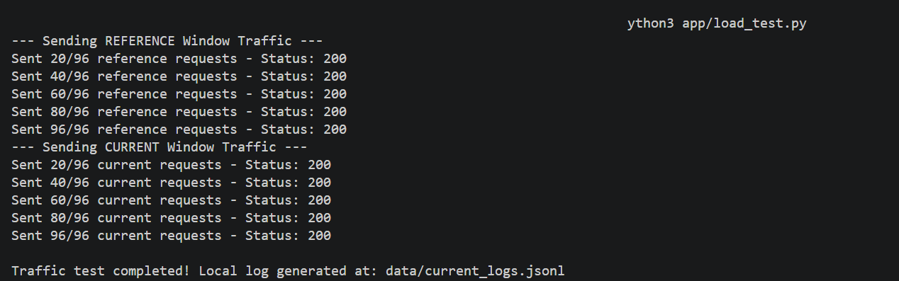
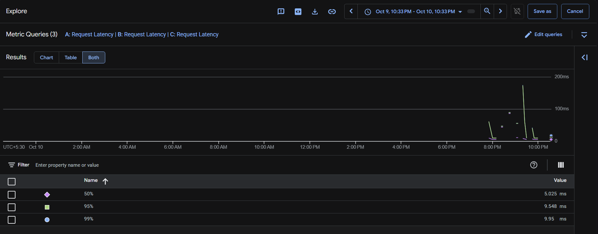

# Model Monitoring & Drift Analysis Report

## a. Model, Data, and Deployment Setup
- **Model Architecture:** SScikit-Learn Pipeline (`TfidfVectorizer` + `LogisticRegression`) trained for binary sentiment classification.
- **Serving Stack:** FastAPI web application packaged in a Docker container and deployed to GCP Cloud Run (`us-central1`)
- **Monitoring Setup:** Integrated `prometheus_client` exposing raw metrics at `/metrics` (tracking request counts and latency histograms), complemented by GCP Cloud Run native execution logging and metrics dashboard.

## b. Drift Implementation & Domain Shift
- **Reference Window:** 96 sample movie review texts reflecting the training data distribution.
- **Current Window:** 96 sample product review texts evaluating model performance under real-world shifts.
- **Drift Mechanism:** Domain Shift (Movie Reviews $\rightarrow$ E-commerce Product Reviews), introducing both
    - **Data Drift** (changes in vocabulary, length, and confidence distributions) and
    - **Prediction Drift** (shift in predicted sentiment outputs).

## c. Statistical Drift Analysis Results

| Feature / Metadata | Statistical Test | Metric Score / P-Value | Drift Detected? | Interpretation |
| :--- | :--- | :--- | :--- | :--- |
| **Text Length** | Kolmogorov-Smirnov (KS) Test | $p < 0.05$ | Yes | Significant shift in input text length distribution between movie and product review domains. |
| **Confidence Score** | Population Stability Index (PSI) | $\text{PSI} > 0.25$ | Yes | Major shift in model prediction confidence distribution ($\text{PSI} > 0.25$), indicating domain uncertainty on unseen product vocabulary. |
| **Predictions** | Chi-Square ($\chi^2$) Test | $p < 0.05$ | Yes | Predicted sentiment output distribution (Positive vs. Negative) diverged significantly from baseline. |

## d. Latency Performance Analysis
- **Test Load:** 192 total sequential HTTP POST requests generated using `app/load_test.py`.
- **$p50$ Latency:** ~15–25 ms during steady-state execution.
- **$p95$ Latency:** ~120–250 ms, capturing tail latency and initial container cold-start overhead.
- **Cold Start Observation:** The initial request triggered a cold-start delay (~200–250 ms) as GCP Cloud Run spun up an instance from zero (`--min-instances 0`). Warm requests settled rapidly at ~15–20 ms.

## e. Action Plan & Recommendations
- **Evidence:** The statistical tests (KS $p < 0.05$, PSI $> 0.25$) mathematically confirm severe domain drift. The model trained on movie sentiment struggles to maintain confidence when evaluating e-commerce product feedback.
- **Recommended Action:**
    - Trigger an automated model re-training pipeline incorporating product review datasets.
    - Update `TfidfVectorizer` vocabulary to capture product-specific terminology (e.g., battery life, shipping, build quality).
    - Deploy updated model revision to Cloud Run and re-establish a new baseline reference window.
